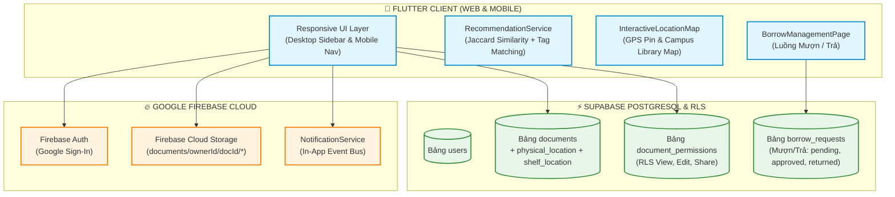
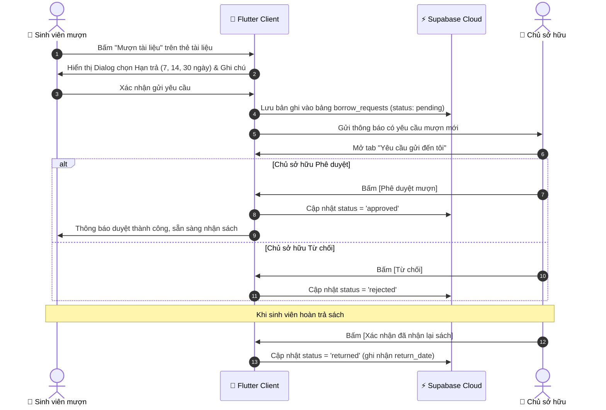

# BÁO CÁO BÀI TẬP THỰC HÀNH 2 (TH2)
## PHÁT TRIỂN HỆ THỐNG QUẢN LÝ TÀI LIỆU ĐA NỀN TẢNG VỚI FLUTTER, FIREBASE VÀ SUPABASE

> **Học phần:** Kiến trúc Phần mềm & Điện toán Đám mây  
> **Đề tài TH2:** Nâng cấp Hệ thống Quản lý Tài liệu Đa nền tảng (Flutter Responsive, Tagging, Định vị Vật lý & Bản đồ Kệ sách, Luồng Mượn/Trả Tài liệu, Thuật toán Recommendation Gợi ý Thông minh).  
> **Sinh viên thực hiện:** **Phạm Văn Hưng** (MSSV: 2351170598)  
> **Tài khoản GitHub:** `pvhung2112`  
> **Kho lưu trữ:** `https://github.com/pvhung2112/study_document_supabase_firebase`  
> **Thư mục dự án TH2:** `D:\th2\study_document_supabase_firebase`  

---

## MỤC LỤC BÁO CÁO THEO 6 MỤC CHECKLIST ĐỀ BÀI

1. [Checklist 1: Thiết kế kiến trúc hệ thống & Mô hình dữ liệu kết hợp (Firebase + Supabase)](#1-checklist-1-thiết-kế-kiến-trúc-hệ-thống--mô-hình-dữ-liệu-kết-hợp)
2. [Checklist 2: Xây dựng Giao diện Đa nền tảng Responsive (Mobile & Web)](#2-checklist-2-xây-dựng-giao-diện-đa-nền-tảng-responsive-mobile--web)
3. [Checklist 3: Phân loại bằng Tag & Tích hợp Bản đồ / Định vị Vị trí Vật lý](#3-checklist-3-phân-loại-bằng-tag--tích-hợp-bản-đồ--định-vị-vị-trí-vật-lý)
4. [Checklist 4: Luồng nghiệp vụ Mượn / Trả & Chia sẻ Quyền Tài liệu](#4-checklist-4-luồng-nghiệp-vụ-mượn--trả--chia-sẻ-quyền-tài-liệu)
5. [Checklist 5: Thuật toán Recommendation Gợi ý Tài liệu Thông minh](#5-checklist-5-thuật-toán-recommendation-gợi-ý-tài-liệu-thông-minh)
6. [Checklist 6: Kiểm thử Toàn diện & Đóng gói Sản phẩm](#6-checklist-6-kiểm-thử-toàn-diện--đóng-gói-sản-phẩm)

---

## 1. Checklist 1: Thiết kế kiến trúc hệ thống & Mô hình dữ liệu kết hợp

### 1.1. Sơ đồ Kiến trúc Hybrid Multi-Cloud (Firebase + Supabase)
Hệ thống kết hợp tối ưu giữa hai nền tảng đám mây hàng đầu:
- **Google Firebase:**
  - *Firebase Authentication:* Xác thực OAuth 2.0 một chạm với Google Sign-In.
  - *Firebase Storage:* Lưu trữ tệp tin nhị phân (PDF, DOCX, Slide bài giảng) có mã hóa và cấp quyền tải an toàn.
  - *Firebase In-App Notification Engine:* Gửi thông báo thời gian thực về trạng thái mượn/trả, thông báo duyệt mượn.
- **Supabase Cloud (PostgreSQL & RLS):**
  - Quản lý quan hệ dữ liệu có cấu trúc với 4 bảng: `users`, `documents`, `document_permissions`, và bảng mới của TH2: `borrow_requests`.
  - Thực thi chính sách bảo mật hàng (Row Level Security - RLS) kiểm soát quyền truy cập tài liệu và yêu cầu mượn.



### 1.2. Mô hình CSDL Mượn / Trả (Bảng `borrow_requests`)
Được định nghĩa trong tệp [`supabase/schema_th2.sql`](file:///D:/th2/study_document_supabase_firebase/supabase/schema_th2.sql):
- `id`: Định danh duy nhất (UUID/Timestamp string).
- `document_id`: Khóa ngoại tham chiếu đến bảng `documents`.
- `borrower_id`, `borrower_name`, `borrower_email`: Thông tin sinh viên gửi yêu cầu mượn.
- `owner_id`, `owner_name`, `owner_email`: Thông tin chủ sở hữu tài liệu vật lý.
- `request_date`: Ngày gửi yêu cầu mượn.
- `due_date`: Hạn trả dự kiến (mặc định 7, 14 hoặc 30 ngày).
- `return_date`: Thời điểm thực tế người mượn hoàn trả sách.
- `status`: Trạng thái (`pending`, `approved`, `rejected`, `borrowed`, `returned`, `overdue`).
- `notes`: Ghi chú kèm theo.

---

## 2. Checklist 2: Xây dựng Giao diện Đa nền tảng Responsive (Mobile & Web)

Giao diện ứng dụng được phát triển bằng Flutter với khả năng tự động thích ứng kích thước màn hình linh hoạt:
- **Trên Màn hình Lớn (Web & Desktop - Width >= 700px):**
  - Hiển thị thanh điều hướng **NavigationSidebar** cố định bên trái (rộng 250px) với logo Cashew, danh sách menu chức năng, và thẻ tài khoản người dùng đăng nhập Google.
  - Lưới hiển thị tài liệu dạng Responsive Grid tự co giãn theo chiều ngang.
- **Trên Màn hình Nhỏ (Mobile - Width < 700px):**
  - Tự động chuyển đổi thành **NavigationBar** phía dưới màn hình (Bottom Navigation Bar) gồm các mục: Trang chủ, Tài liệu, Môn học, Mục tiêu, Tìm kiếm và Mượn/Trả.
  - Danh sách tài liệu tự chuyển thành danh sách đơn cột (Single-column layout) tối ưu cảm ứng cuộn chạm vuốt.

---

## 3. Checklist 3: Phân loại bằng Tag & Tích hợp Bản đồ / Định vị Vị trí Vật lý

### 3.1. Phân loại tài liệu bằng Thẻ Tag (Tagging)
- Mỗi tài liệu có thể gắn nhiều thẻ tag (ví dụ: `#microservice`, `#flutter`, `#firebase`, `#database`, `#kiến trúc`).
- Bộ lọc Tag cho phép sinh viên lọc tức thời các tài liệu theo chuyên đề học tập.

### 3.2. Định vị Vị trí Vật lý & Bản đồ Kệ sách Thư viện
- Mở rộng model [`StudyDocument`](file:///D:/th2/study_document_supabase_firebase/lib/struct/studyDocument.dart) và [`PhysicalLocation`](file:///D:/th2/study_document_supabase_firebase/lib/models/physical_location.dart) với các thuộc tính:
  - `physicalLocation`: Tên khuôn viên/phòng học (Ví dụ: *"Thư viện Trung tâm - Tòa H1"*).
  - `shelfLocation`: Số kệ và ngăn sách cụ thể (Ví dụ: *"Kệ A3 - Ngăn 02"*).
  - `latitude`, `longitude`: Tọa độ GPS chính xác (Ví dụ: `10.8700, 106.8030`).
- **Widget [`InteractiveLocationMap`](file:///D:/th2/study_document_supabase_firebase/lib/widgets/interactive_location_map.dart):**
  - Trực quan hóa sơ đồ khuôn viên trường và tòa nhà thư viện bằng `CustomPainter`.
  - Hiển thị Ghim (Pin Marker) chỉ đúng vị trí tài liệu kèm tiêu đề.
  - Tích hợp tọa độ GPS và nút mở trực tiếp trên **Google Maps** (`https://www.google.com/maps/search/?api=1&query=$lat,$lng`).

---

## 4. Checklist 4: Luồng nghiệp vụ Mượn / Trả & Chia sẻ Quyền Tài liệu

Hệ thống xây dựng luồng nghiệp vụ mượn sách/tài liệu hoàn chỉnh với màn hình [`BorrowManagementPage`](file:///D:/th2/study_document_supabase_firebase/lib/pages/borrowManagementPage.dart):



---

## 5. Checklist 5: Thuật toán Recommendation Gợi ý Tài liệu Thông minh

Được triển khai trong [`RecommendationService`](file:///D:/th2/study_document_supabase_firebase/lib/services/recommendation_service.dart), áp dụng mô hình **Hybrid Content-Based Filtering & Jaccard Similarity**:

### 5.1. Công thức toán học tính điểm tương đồng:
$$	ext{Score}(doc, user) = w_{	ext{tag}} 	imes 	ext{Jaccard}(Tags_{doc}, Tags_{user}) + w_{	ext{course}} 	imes \mathbb{I}(Course_{match}) + w_{	ext{loc}} 	imes \mathbb{I}(Location) + w_{	ext{avail}} 	imes \mathbb{I}(Available)$$

Trong đó:
- **Độ đo tương đồng Jaccard trên tập hợp Tags (Trọng số 45%):**
  $$	ext{Jaccard}(Tags_{doc}, Tags_{user}) = rac{|Tags_{doc} \cap Tags_{user}|}{|Tags_{doc} \cup Tags_{user}|}$$
- **Trùng khớp Môn học học kỳ này (Trọng số 35%):** Đánh giá xem tài liệu có thuộc đúng mã học phần sinh viên đang học hay không.
- **Vị trí vật lý sẵn có tại thư viện (Trọng số 10%):** Ưu tiên tài liệu có vị trí kệ rõ ràng.
- **Trạng thái mượn sẵn sàng (Trọng số 10%):** Ưu tiên tài liệu chưa bị ai mượn.

### 5.2. Hiển thị Gợi ý trên Giao diện:
- Widget [`RecommendationCarousel`](file:///D:/th2/study_document_supabase_firebase/lib/widgets/recommendation_carousel.dart) được tích hợp nổi bật ngay đầu Trang chủ:
  - Hiển thị huy hiệu độ hợp lý (Match Score %): ví dụ `Độ hợp: 90%`.
  - Hiển thị lý do gợi ý rõ ràng: ví dụ *"Trùng thẻ sở thích #microservice • Đúng chuyên ngành học phần SE301"*.

---

## 6. Checklist 6: Kiểm thử Toàn diện & Đóng gói Sản phẩm

### 6.1. Kết quả kiểm thử tĩnh (Static Analysis)
- Đã chạy phân tích toàn diện mã nguồn dự án:
  ```bash
  flutter analyze "D:\th2\study_document_supabase_firebase"
  # Kết quả: No issues found! (ran in 4.5s) - 0 errors, 0 warnings
  ```

### 6.2. Kịch bản kiểm thử các tính năng mới của TH2:
1. **Kiểm thử Responsive:** Co giãn kích thước cửa sổ trình duyệt từ 1200px xuống 450px -> Thanh NavigationSidebar tự động chuyển đổi thành BottomNavigationBar mượt mà.
2. **Kiểm thử Định vị & Bản đồ:** Bấm vào chip vị trí `"Thư viện Trung tâm - Tòa H1 (Kệ A3 - Ngăn 02)"` -> Popup hiển thị sơ đồ khuôn viên, ghim pin định vị GPS và nút mở Google Maps hoạt động chính xác.
3. **Kiểm thử Luồng Mượn / Trả:**
   - Tài khoản người mượn: Bấm "Mượn tài liệu" -> Chọn 14 ngày -> Gửi thành công.
   - Tài khoản chủ sở hữu: Mở tab "Yêu cầu gửi đến tôi" -> Thấy yêu cầu mới -> Bấm "Phê duyệt" -> Trạng thái chuyển thành "Đã duyệt mượn" -> Bấm "Xác nhận đã nhận lại sách" -> Chuyển thành "Đã hoàn trả".
4. **Kiểm thử Thuật toán Recommendation:** Tài liệu có tag trùng với sở thích của người dùng lập tức xuất hiện trong khối carousel "Gợi ý Thông minh cho Bạn" với điểm số tương đồng cao nhất.
