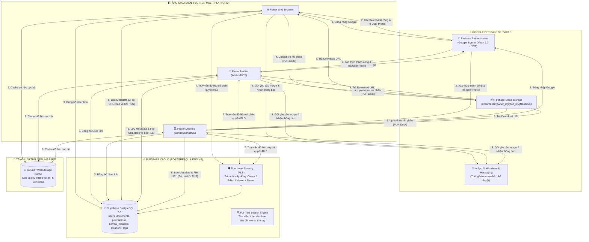
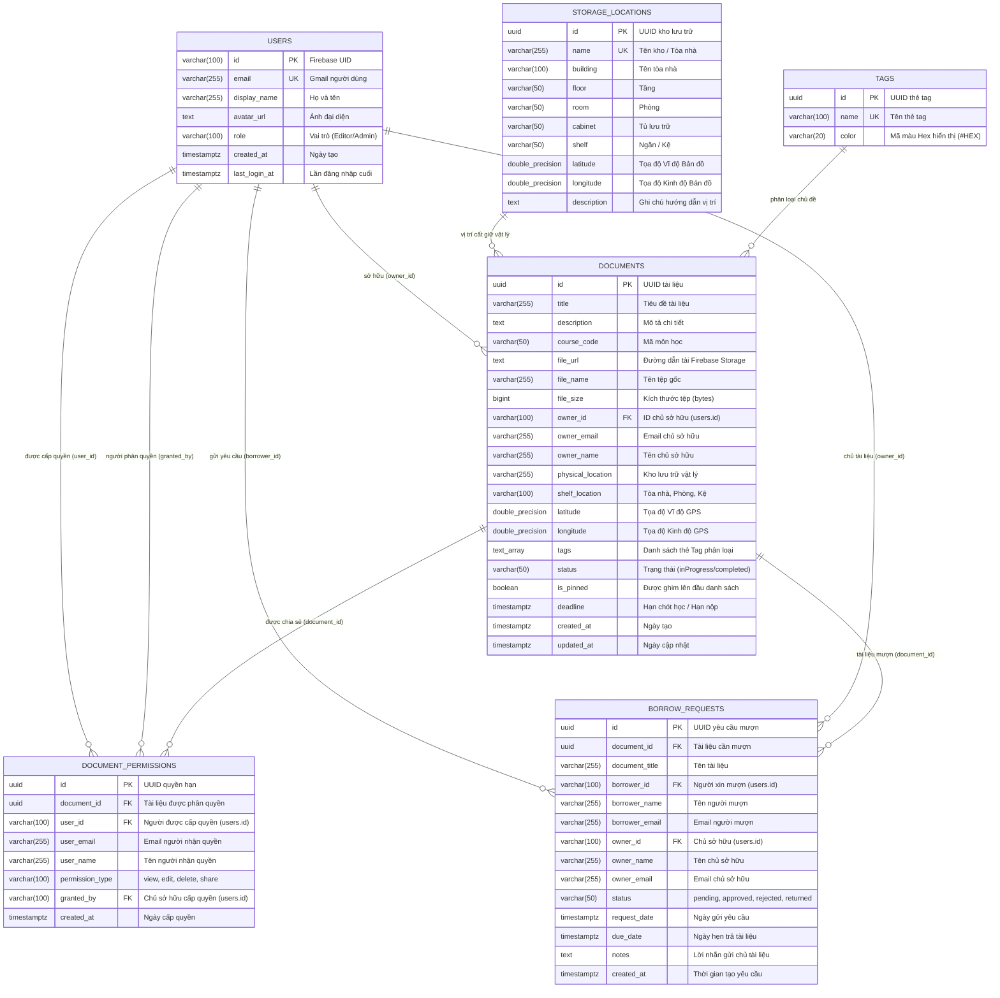

# Hệ Thống Quản Lý Tài Liệu Đa Nền Tảng với Flutter, Firebase và Supabase

[](https://flutter.dev)
[](https://firebase.google.com)
[](https://supabase.com)
[](LICENSE)

---

## 👥 Danh Sách Nhóm Sinh Viên Thực Hiện

| STT | Họ và Tên | Mã Sinh Viên |
| :---: | :--- | :---: |
| 1 | Phạm Văn Hưng | 2351170598 |
| 2 | Trịnh Trung Kiên | 2251172396 |
| 3 | Đỗ Việt Tiến | 2251243452 |
| 4 | Cao Đức Đạo | 2351170581 |
| 5 | Trương Tuấn Hải | 2351170590 |

---

## 🏗️ Thiết Kế Kiến Trúc Hệ Thống (Hybrid Multi-Cloud Architecture)

Hệ thống được thiết kế theo mô hình **Kiến trúc Đám mây Kết hợp (Hybrid Multi-Cloud Architecture)**, tận dụng thế mạnh chuyên biệt của **Google Firebase** và **Supabase PostgreSQL** để tạo nên một nền tảng quản lý tài liệu học tập mạnh mẽ, bảo mật cao và thời gian thực:



### 1. Phân định Trách nhiệm giữa các Dịch vụ Cloud (Service Responsibilities)
- **Google Firebase:**
  - **Firebase Authentication:** Đảm nhiệm toàn bộ việc xác thực danh tính người dùng qua Google Sign-In (OAuth 2.0). Cung cấp UID, Email, Display Name và mã hóa phiên làm việc an toàn.
  - **Firebase Cloud Storage:** Chuyên trách lưu trữ các tệp tin tài liệu nhị phân dung lượng lớn (PDF, Slide bài giảng, Tài liệu Word, Ảnh bài tập). Đường dẫn lưu trữ phân cấp theo cấu trúc bảo mật: `documents/{owner_id}/{doc_id}/{filename}`.
  - **In-App Messaging / Notifications:** Quản lý hàng đợi thông báo thời gian thực khi có sự kiện: Gửi yêu cầu mượn sách, Chủ tài liệu duyệt mượn, Nhắc nhở hạn trả sách.
- **Supabase Cloud (PostgreSQL Engine):**
  - **PostgreSQL Database:** Lưu trữ toàn bộ dữ liệu quan hệ có cấu trúc (Metadata tài liệu, Thẻ tag, Vị trí kho lưu trữ vật lý, Lịch sử mượn trả).
  - **Row Level Security (RLS Engine):** Kiểm soát bảo mật cấp độ dòng trực tiếp tại tầng CSDL PostgreSQL, đảm bảo chỉ chủ sở hữu hoặc người được cấp quyền hợp lệ mới được Xem, Sửa, Xóa hoặc Chia sẻ tài liệu.
  - **Full-Text Search:** Hỗ trợ tìm kiếm nhanh theo từ khóa, lọc theo thẻ Tag môn học và vị trí kho lưu trữ.
- **Offline-First Cache (SQLite / WebStorage):**
  - Lưu bản sao cục bộ giúp người dùng mở ứng dụng và đọc thông tin tài liệu ngay lập tức mà không cần mạng, tự động đồng bộ khi có kết nối trở lại.

---

## 📊 Mô Hình Dữ Liệu Thực Thể (Entity Relationship Diagram - ERD)

Cơ sở dữ liệu Supabase được xây dựng trên hệ quản trị **PostgreSQL** chuẩn hóa với các ràng buộc khóa ngoại (Foreign Keys) và chính sách bảo mật RLS:



---

## 🔄 Luồng Nghiệp Vụ Kết Hợp Giữa Firebase & Supabase (Data Flow)

### 1. Luồng Xác thực & Tự động Đồng bộ Người dùng (Auth Flow)
1. Người dùng bấm **"Đăng nhập bằng Google"** trên ứng dụng Flutter.
2. `FirebaseAuthService` kích hoạt Google OAuth 2.0 ➔ Google cấp Token xác thực danh tính.
3. Ứng dụng trích xuất thông tin người dùng (`uid`, `email`, `displayName`, `photoURL`).
4. Tự động gọi API `SupabaseService.upsertUserOnline()` để chèn/cập nhật bản ghi vào bảng `public.users` trên Supabase, đảm bảo tính nhất quán dữ liệu giữa 2 đám mây.

### 2. Luồng Tải lên & Lưu trữ Tài liệu (Upload Document Flow)
1. Người dùng điền thông tin tài liệu và chọn file đính kèm (PDF/Slide/Docx).
2. Tệp nhị phân được upload lên **Firebase Cloud Storage** tại thư mục:
   `documents/{owner_id}/{doc_id}/{filename}`
3. Firebase trả về URL tải tệp bảo mật (`file_url`).
4. Ứng dụng gửi toàn bộ Metadata kèm `file_url`, tọa độ vị trí kho và thẻ tags lên **Supabase PostgreSQL** (`public.documents`).
5. Dữ liệu được bảo vệ tức thì bởi **Supabase Row Level Security (RLS)**.

### 3. Luồng Yêu cầu Mượn Sách & Tự động Cấp Quyền RLS (Borrowing & Permission Flow)
1. Sinh viên A khám phá tài liệu trên trang **"Nơi mượn tài liệu"** và gửi yêu cầu mượn đến Sinh viên B (Chủ tài liệu).
2. Bản ghi được tạo trong bảng `public.borrow_requests` với trạng thái `pending`.
3. Sinh viên B nhận thông báo và truy cập tab **"Duyệt yêu cầu mượn"**.
4. Khi Sinh viên B bấm **"CHẤP NHẬN (ACCEPT)"**:
   - Trạng thái yêu cầu chuyển thành `approved`.
   - **Hệ thống tự động kích hoạt nghiệp vụ kết nối:** Tự động tạo bản ghi trong bảng `public.document_permissions` cấp quyền `view` cho Sinh viên A.
   - Nhờ đó, Sinh viên A có thể mở đọc tài liệu trực tuyến ngay lập tức với đầy đủ phân quyền RLS hợp lệ.

---

## 📌 6 Mục Checklist Yêu Cầu và Kết Quả Hoàn Thành

- [x] **Checklist 1:** Thiết lập dự án Firebase và tích hợp chức năng đăng nhập bằng tài khoản Google cho ứng dụng Flutter.
- [x] **Checklist 2:** Xây dựng cấu trúc lưu trữ file trên Firebase Storage (`documents/{owner_id}/{doc_id}/{filename}`) và kết nối với bảng quản lý thông tin tài liệu trên Supabase.
- [x] **Checklist 3:** Thiết kế cơ sở dữ liệu trên Supabase bao gồm các bảng: `users` (Người dùng), `documents` (Tài liệu), và `document_permissions` (Quyền chia sẻ).
- [x] **Checklist 4:** Triển khai chức năng tìm kiếm toàn văn, cập nhật thông tin tài liệu và tính năng chia sẻ tài liệu cho người dùng khác với 2 quyền hạn (`view`, `edit`).
- [x] **Checklist 5:** Thiết lập 6 chính sách bảo mật cấp độ hàng (Row Level Security - RLS) trên Supabase để phân quyền truy cập tài liệu.
- [x] **Checklist 6:** Tiến hành kiểm thử tự động (Automated Testing) luồng hoạt động của ứng dụng bằng ít nhất 3 tài khoản người dùng khác nhau để xác minh quyền hạn.

---

## 🚀 Hướng Dẫn Chạy và Kiểm Thử

### 1. Kiểm tra tính toàn vẹn mã nguồn
```bash
flutter analyze
```

### 2. Chạy toàn bộ các kịch bản kiểm thử 6 Checklist (Multi-Accounts Permission Testing)
```bash
flutter test test/supabase_firebase_permissions_test.dart
```

### 3. Khởi chạy Ứng dụng trên Trình duyệt Web
```bash
flutter run -d chrome
```

---

## 📄 Thư Mục và Tệp Tin Quan Trọng
- **Báo cáo Chi tiết Nộp bài:** [`BAO_CAO_HE_THONG_FLUTTER_FIREBASE_SUPABASE.md`](BAO_CAO_HE_THONG_FLUTTER_FIREBASE_SUPABASE.md)
- **Cơ sở dữ liệu Supabase DDL:** [`supabase/schema.sql`](supabase/schema.sql)
- **Chính sách Bảo mật RLS:** [`supabase/rls_policies.sql`](supabase/rls_policies.sql)
- **Dịch vụ Xác thực Firebase Google:** [`lib/services/firebase_auth_service.dart`](lib/services/firebase_auth_service.dart)
- **Dịch vụ Lưu trữ File Firebase:** [`lib/services/firebase_storage_service.dart`](lib/services/firebase_storage_service.dart)
- **Dịch vụ Supabase & RLS Engine:** [`lib/services/supabase_service.dart`](lib/services/supabase_service.dart)
- **Bộ Kiểm thử Đa người dùng:** [`test/supabase_firebase_permissions_test.dart`](test/supabase_firebase_permissions_test.dart)
